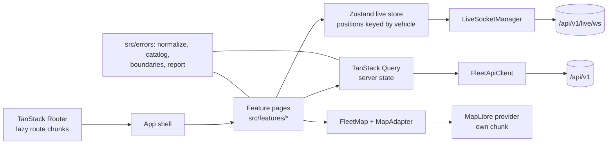

# Fleet Tracking Web

A map-first control console for fleet dispatchers, security teams and viewers. It tracks vehicles, trips, alerts, geofences and driver assignments in real time, and it is honest when it cannot.

This repository is the frontend. It talks to the fleet API described in [`docs/api/openapi.yaml`](docs/api/openapi.yaml).

## Stack

- Vite, React 19 and TypeScript in strict mode
- Tailwind CSS v4 with semantic design tokens
- TanStack Router (route-level chunks) and TanStack Query (server state)
- Zustand for live positions and connection state
- Zod at every API and WebSocket boundary
- MapLibre with a provider-neutral `MapAdapter` contract
- Vitest, Testing Library, MSW and Playwright
- `vite-plugin-pwa` (Workbox) for the precached shell, PMTiles range cache, and IndexedDB query persistence

## Getting started

```bash
npm install
npx playwright install --with-deps chromium   # once, for the e2e suite
npm run dev
```

Open `http://localhost:5173`. The dev server proxies `/api` (including the WebSocket upgrade) to staging.

| Variable                | Purpose                                                                                               |
| ----------------------- | ----------------------------------------------------------------------------------------------------- |
| `VITE_MOCK=1`           | Run against MSW fixtures instead of staging. `?map=fake` selects the deterministic map adapter.       |
| `VITE_PROXY_TARGET`     | Point the dev proxy at a local backend instead of staging.                                            |
| `VITE_API_BASE`         | Must stay empty. The API is same-origin only; a different origin breaks cookies, CORS and the socket. |
| `VITE_MAPTILER_API_KEY` | Enables the Streets and Satellite styles. Without it only the standard OpenFreeMap style is offered.  |
| `VITE_MAP_PMTILES_URL`  | A self-hosted PMTiles pack for the offline basemap.                                                   |
| `VITE_DEMO_HINTS=1`     | Staging-only prefill buttons on the login screen. Never present in a production build.                |
| `VITE_FLEET_DEBUG=1`    | Exposes `window.__FLEET_DEBUG__` in a production build for the PWA suite.                             |

`.env.example` lists every variable. `.env.local` is ignored.

## Architecture



The map is the product. Every feature speaks the `MapAdapter` contract (`src/map/types.ts`); only `src/map/providers/*` imports a map SDK, and `npm run guard` enforces it.

## How to verify

| Tier | Command                        | When                                                                              |
| ---- | ------------------------------ | --------------------------------------------------------------------------------- |
| T0   | `npm run check`                | Every checkpoint: typecheck, type-aware lint, design guard, Prettier, unit tests. |
| T1   | `npm run e2e:fast -- <specs>`  | While building: one desktop and one mobile project, light and dark.               |
| T2   | `npm run e2e:slice -- <specs>` | End of a slice: the slice's specs on all four projects.                           |
| T3   | `npm run e2e`                  | Merge gate and shared-code changes.                                               |
| PWA  | `npm run e2e:pwa`              | Service worker, offline cache and PMTiles range requests.                         |

Playwright warms every route once before the workers (`e2e/global-setup.ts`). Local runs use at most four workers and no retries; CI uses one retry.

Other commands:

| Command                  | Purpose                                                                                                                                             |
| ------------------------ | --------------------------------------------------------------------------------------------------------------------------------------------------- |
| `npm run build`          | Typecheck, check the map pack, build, write `docs/bundle-report.md`, enforce the budgets and assert no demo credentials in `dist`.                  |
| `npm run bundle:report`  | Re-print the bundle table from `dist/.vite/manifest.json`.                                                                                          |
| `npm run contract:check` | Validate one real staging response per endpoint against the parsers. Needs `FLEET_STAGING_EMAIL` and `FLEET_STAGING_PASSWORD` (admin for `/audit`). |
| `npm run capture:live`   | Record 30 seconds of live frames, print only field names, and write a sanitised capture to `test-results/`.                                         |
| `npm run csp:hash`       | Print the CSP hash for the inline theme bootstrap.                                                                                                  |
| `npm run qa:checklist`   | Turn `test-results/review/*.png` into `docs/qa-checklist.md`.                                                                                       |
| `npm run e2e:slowest`    | Print the slowest tests from the last Playwright JSON report.                                                                                       |
| `npm run e2e:review`     | Run Playwright with review screenshots at 1440px and 390px.                                                                                         |
| `npm run deploy`         | Deploy `dist/` to Cloudflare Workers.                                                                                                               |

The full error contract, including every fault scenario and its surface, is in [`docs/error-handling.md`](docs/error-handling.md). The visual contract is `/styleguide` in both themes and all four accents.

## Staging

The API is same-origin only and the staging tenant is shared. The demo accounts and the demo password are documented in [`docs/README.md`](docs/README.md); never put them in a production build (`scripts/assert-bundle.sh` fails the build if they appear in `dist`).

Run the drift check after any backend change:

```bash
FLEET_STAGING_EMAIL=admin@demo.ftb FLEET_STAGING_PASSWORD=… npm run contract:check
```

The check logs in once, keeps the cookie and CSRF token in memory, validates every parser against a real response, and exercises the 401 and CSRF-403 envelopes. Its only write is a header-only CSV upload, which creates a zero-row import job.

## Deployment

The SPA is served by a Cloudflare Worker that proxies `/api` and the WebSocket same-origin. Setup, environment variables, caching, rollback and the recommended Content-Security-Policy are in [`docs/deployment.md`](docs/deployment.md).

## Documentation map

- [Project context and staging accounts](docs/README.md)
- [API contract](docs/api/openapi.yaml) and [integration notes](docs/api/frontend-integration.md)
- [Screens and flows](docs/ui-brief.md)
- [Design system](docs/design-system.md) and `/styleguide`
- [Error policy](docs/error-handling.md)
- [Decisions and measured numbers](docs/decisions.md)
- [Offline behaviour](docs/offline.md)
- [Bundle report](docs/bundle-report.md) and [human QA checklist](docs/qa-checklist.md)
- [Workflow](docs/workflow.md)
